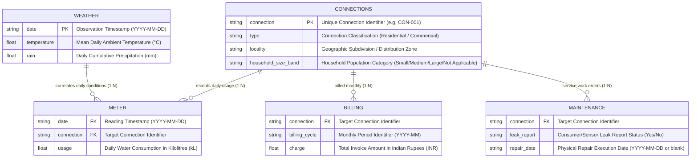

# AquaTrack Utilities: Synthetic Water Usage Dataset Documentation & Data Dictionary

**Project Title:** Water Usage Insight  
**Challenge ID:** Use Case 19  
**Organization:** AquaTrack Utilities  
**Sector:** Sustainability & Water Resource Management  
**Version:** 1.0.0 (Reproducible Synthetic Release, Seed: `42`)  
**Primary Objective:** Deliver a high-fidelity, interconnected synthetic data ecosystem to empower preprocessing, exploratory data analysis (EDA), feature engineering, machine learning-driven anomaly detection, Excel pivot reporting, and executive conservation strategy.

---

## 1. Executive Summary & Architecture Overview

AquaTrack Utilities is a municipal and regional water utility responsible for supplying clean water across residential subdivisions, dense urban quarters, and commercial/industrial corridors. This suite of synthetic datasets simulates seven calendar months (January 1, 2024 to July 31, 2024; 213 consecutive days) of operational telemetry, consumer metadata, monthly billing charges, meteorological conditions, and field maintenance logs.

The architecture reflects real-world Advanced Metering Infrastructure (AMI) and Supervisory Control and Data Acquisition (SCADA) deployments, capturing both natural consumer behaviors and system anomalies (such as distribution network pipe bursts, household fixture leaks, and telemetry packet loss).

### 1.1 Relational Architecture & Entity-Relationship (ER) Diagram

The datasets are linked via foreign keys anchored on `connection` (unique water meter connection ID) and `date` (calendar timestamp in `YYYY-MM-DD` ISO-8601 format).

---

## 2. Comprehensive Data Dictionary

### 2.1 `connections.csv`
- **Description:** Master registry of customer service endpoints.
- **Granularity:** One row per physical customer connection.
- **Target Record Count:** 120 rows.
- **Primary Key:** `connection`

| Column Name | Storage Type | Clean Type | Units / Format | Nullable? | Permitted / Domain Values | Description & Purpose | Example |
| :--- | :--- | :--- | :--- | :---: | :--- | :--- | :--- |
| `connection` | String | `category` / `str` | `CON-[0-9]{3}` | **No** | Unique strings `CON-001` to `CON-120` | Unique alphanumeric identifier for each utility meter connection point. | `CON-042` |
| `type` | String | `category` | Categorical | **No** | Clean: `Residential`, `Commercial` *(Raw contains casing/space flaws)* | Legal tariff classification of the premises. Injected with 8 minor casing/whitespace anomalies for cleaning practice. | `Residential`, ` commercial ` |
| `locality` | String | `category` | Nominal | **No** | `Central Ward`, `Green Valley`, `Highland Park`, `Industrial Zone`, `Metro Square`, `Riverside` | District / supply zone of the physical property. Influences demographic profiles and baseline consumption. | `Highland Park` |
| `household_size_band`| String | `category` | Ordinal | **No** | `Small`, `Medium`, `Large`, `Not Applicable` | Estimated occupant count for residential premises. Standardized to `Not Applicable` for commercial accounts. | `Medium`, `Not Applicable` |

---

### 2.2 `meter.csv`
- **Description:** Daily smart meter interval consumption telemetry.
- **Granularity:** One record per connection per calendar date.
- **Target Record Count:** 20,000–30,000 rows (Raw: 25,350 rows before deduplication and filtering).
- **Composite Primary Key (Target):** `(date, connection)`

| Column Name | Storage Type | Clean Type | Units / Format | Nullable? | Permitted / Domain Values | Description & Purpose | Example |
| :--- | :--- | :--- | :--- | :---: | :--- | :--- | :--- |
| `date` | String | `datetime64[ns]` | `YYYY-MM-DD` | **No** | `2024-01-01` to `2024-07-31` | The 24-hour accounting observation timestamp for the smart meter register. | `2024-03-15` |
| `connection` | String | `category` / `str` | `CON-[0-9]{3}` | **No** | Valid foreign key to `connections.csv` | Identifier of the metered endpoint. | `CON-015` |
| `usage` | Float | `float64` | Kilolitres (kL) | **Yes** (150 nulls) | Expected range: `[0.05, 35.0]` *(Raw contains 45 negative entries and 90 high spikes)* | Daily water volume drawn through the meter. 1 kL = 1,000 Litres = 1 m³. | `0.842`, `-1.205`, `22.450` |

---

### 2.3 `billing.csv`
- **Description:** Monthly aggregated utility invoice ledger.
- **Granularity:** One record per connection per billing cycle.
- **Target Record Count:** 600–1,000 rows (Generated: 854 rows).
- **Composite Primary Key (Target):** `(connection, billing_cycle)`

| Column Name | Storage Type | Clean Type | Units / Format | Nullable? | Permitted / Domain Values | Description & Purpose | Example |
| :--- | :--- | :--- | :--- | :---: | :--- | :--- | :--- |
| `connection` | String | `category` / `str` | `CON-[0-9]{3}` | **No** | Contains 120 valid keys + 7 unmatched IDs (`CON-951` to `CON-957`) | Reference connection ID. Includes 14 orphaned billing lines to test referential integrity validation. | `CON-088`, `CON-954` |
| `billing_cycle` | String | `Period('M')` | `YYYY-MM` | **No** | `2024-01` through `2024-07` | Calendar billing interval representing 1 fiscal service month. | `2024-05` |
| `charge` | Float | `float64` | INR (₹) | **Yes** (20 nulls) | `₹160.00` to `₹18,500.00` (Strictly non-negative) | Total invoiced sum computed via multi-tier volumetric tariffs plus municipal fixed surcharges. | `645.50`, `null` |

---

### 2.4 `weather.csv`
- **Description:** Regional meteorological station ambient climate observations.
- **Granularity:** One record per calendar day across the entire study duration.
- **Target Record Count:** 213 rows (Jan 1, 2024 – Jul 31, 2024).
- **Primary Key:** `date`

| Column Name | Storage Type | Clean Type | Units / Format | Nullable? | Permitted / Domain Values | Description & Purpose | Example |
| :--- | :--- | :--- | :--- | :---: | :--- | :--- | :--- |
| `date` | String | `datetime64[ns]` | `YYYY-MM-DD` | **No** | `2024-01-01` to `2024-07-31` | Date of climate observation. Matches telemetry timeline. | `2024-04-18` |
| `temperature` | Float | `float64` | Degrees Celsius (°C) | **Yes** (6 nulls) | `16.0` to `44.5` °C | 24-hour mean ambient dry-bulb temperature recorded by the municipal weather bureau. | `34.8` |
| `rain` | Float | `float64` | Millimetres (mm) | **Yes** (6 nulls) | `0.0` to `75.0` mm | Cumulative daily surface precipitation measured by digital tipping bucket rain gauges. | `0.0`, `28.4` |

---

### 2.5 `maintenance.csv`
- **Description:** Utility field engineering work orders, leak call center logs, and pipe repair history.
- **Granularity:** One record per recorded inspection or reported plumbing failure.
- **Target Record Count:** 50–100 rows (Generated: 75 rows).
- **Primary Key:** `connection` (unique per work order log).

| Column Name | Storage Type | Clean Type | Units / Format | Nullable? | Permitted / Domain Values | Description & Purpose | Example |
| :--- | :--- | :--- | :--- | :---: | :--- | :--- | :--- |
| `connection` | String | `category` / `str` | `CON-[0-9]{3}` | **No** | 70 valid connections + 5 unmatched IDs (`CON-981` to `CON-985`) | Meter ID associated with the inspection or leak ticket. | `CON-012`, `CON-982` |
| `leak_report` | String | `category` | Categorical | **Yes** (3 nulls) | Clean: `Yes`, `No` | Indicates whether customer or acoustics sensor flagged an active water leak. | `Yes`, `No`, `null` |
| `repair_date` | String | `datetime64[ns]` | `YYYY-MM-DD` | **Yes** (41 blank) | `2024-02-15` to `2024-06-25` or blank | Date when utility plumbing crews successfully patched the leak. Blank for non-leaks and unresolved reports. | `2024-03-22`, `""` |

---

## 3. Data Generation Methodology & Statistical Modeling

The datasets were synthesized programmatically in Python (`numpy` & `pandas`) using random seed `42` to guarantee exact mathematical reproducibility.

### 3.1 Residential vs. Commercial Baselines
Water consumption exhibits distinct micro-behavioral patterns based on consumer classification and household occupancy:
- **Residential Small** (1–2 persons): Baseline $\approx 0.42\text{ kL/day}$ ($\sim 210\text{ L/person/day}$).
- **Residential Medium** (3–4 persons): Baseline $\approx 0.88\text{ kL/day}$ ($\sim 220\text{ L/person/day}$).
- **Residential Large** (5+ persons): Baseline $\approx 1.55\text{ kL/day}$ ($\sim 220\text{ L/person/day}$ + garden/appliance usage).
- **Commercial Small Retail / Offices (Central Ward / Riverside):** Baseline $\approx 4.2 - 6.5\text{ kL/day}$.
- **Commercial Corporate / Hospitality (Metro Square):** Baseline $\approx 9.8\text{ kL/day}$.
- **Light Manufacturing / Industrial (Industrial Zone):** Baseline $\approx 14.5\text{ kL/day}$.

### 3.2 Geographic & Locality Multipliers
Demographic zoning produces systematic consumption variances:
- `Highland Park` ($1.25\times$): Affluent estates, automatic lawn sprinklers, private swimming pools.
- `Green Valley` ($1.10\times$): Suburban detached properties with gardens.
- `Riverside` ($1.00\times$): Baseline reference district with mixed residential/retail.
- `Central Ward` ($0.92\times$): High-density multi-story apartments with compact living.
- `Metro Square` ($1.00\times$): Commercial business district.
- `Industrial Zone` ($1.12\times$): Commercial and processing plants.

### 3.3 Temporal & Calendar Factors
- **Residential:** Weekends (Saturday and Sunday) demonstrate a $+18\%$ consumption bump ($1.18\times$) due to home laundry, cooking, cleaning, and gardening. Mondays represent a slight trough ($0.95\times$).
- **Commercial:** Operating hours peak on weekdays Monday–Friday ($1.12\times$), dropping sharply on Saturday ($0.75\times$) and Sunday ($0.45\times$).

### 3.4 Meteorological Response Models
- **Temperature Response:** For each $1^\circ\text{C}$ elevation above $27^\circ\text{C}$, consumer demand scales by $+1.2\%$ due to increased showering, cooling towers, and landscape watering:
  $$\text{Factor}_{\text{temp}} = 1.0 + (\text{Temperature} - 27.0) \times 0.012$$
- **Precipitation Dampening:** When daily precipitation exceeds $8\text{ mm}$, demand drops to $0.88\times$ (a $12\%$ reduction) as automated sprinkler systems disengage and municipal outdoor washing ceases. Minor showers ($1-8\text{ mm}$) produce a $6\%$ reduction ($0.94\times$).

### 3.5 Physical Leak Lifecycle Simulation
1. **Repaired Leaks (26 Connections):**
   - Leak begins silently $30-50\text{ days}$ prior to the logged `repair_date`.
   - Continuous water loss adds $+2.5$ to $+4.8\text{ kL/day}$ above normal baseline consumption.
   - Upon `repair_date`, consumption immediately drops back to normal baselines.
2. **Unresolved Active Leaks (12 Connections):**
   - Placed in service early-to-mid season (days 45 to 105).
   - Leak persists unchecked, adding $+3.0$ to $+5.5\text{ kL/day}$ throughout the rest of the dataset.
3. **Plumbing Spikes / Fixture Bursts (90 Isolated Incidents):**
   - Transformed points simulate acute incidents (open valves, toilet flapper failures, garden hose ruptures) adding $+9.0$ to $+24.0\text{ kL}$ on isolated dates.

### 3.6 Realistic Tariff Structure (INR $\mathbf{₹}$)
Invoicing mirrors modern progressive block rate structures:
- **Residential Tariff Schedule:**
  - Fixed Meter Fee: $₹160.00 / \text{month}$
  - Tier 1 ($0 - 15\text{ kL}$): $₹24.00 / \text{kL}$
  - Tier 2 ($15 - 30\text{ kL}$): $₹42.00 / \text{kL}$
  - Tier 3 ($> 30\text{ kL}$): $₹72.00 / \text{kL}$
- **Commercial Tariff Schedule:**
  - Fixed Meter Fee: $₹650.00 / \text{month}$
  - Tier 1 ($0 - 100\text{ kL}$): $₹75.00 / \text{kL}$
  - Tier 2 ($> 100\text{ kL}$): $₹105.00 / \text{kL}$
- Surcharges: $\pm 2\%$ municipal drainage / local service variance.

---

## 4. Injected Data Quality Flaws & Cleaning Playbook

To ensure realistic data engineering and exploratory data analysis practice, 13 specific data quality flaws have been intentionally seeded across the datasets in controlled proportions.

| # | Dataset | Target Column | Issue Category | Exact Count | Engineering Root Cause | Recommended Treatment Strategy |
| :-: | :--- | :--- | :--- | :-: | :--- | :--- |
| **1** | `meter.csv` | `usage` | Missing Values | 150 | Telemetry packet corruption; CRC checksum failure. | Impute with rolling 7-day median for the same connection, or KNN imputer conditioned on locality and household size. |
| **2** | `meter.csv` | `usage` | Negative Values | 45 | Backflow valve failure, mechanical reverse spin, or manual sign inversion. | Inspect reverse-flow logs. If entry error, apply `abs(usage)`. If mechanical backflow error, set to `NaN` and interpolate linearly. |
| **3** | `meter.csv` | `(date, connection)` | Duplicate Records | 210 | Dual cellular gateway telemetry re-transmission. | Deduplicate using `df.drop_duplicates(subset=['date', 'connection'], keep='first')`. |
| **4** | `meter.csv` | `(date, connection)` | Missing Days | 420 | Smart meter battery depletion or cellular network blackout. | Generate a complete multi-index grid of all `date` $\times$ `connection` pairs. Reindex to expose temporal gaps; apply forward-fill or seasonal interpolation. |
| **5** | `meter.csv` | `usage` | High Spikes | 90 | Genuine plumbing ruptures, fixture leaks, pool filling. | **Do not drop!** Isolate using Isolation Forest or Z-Score ($Z > 3.5$) for anomaly detection modeling and customer leak alerts. |
| **6** | `connections.csv` | `type` | Inconsistent Strings | 8 | Unsanitized manual keyboard entry (leading/trailing whitespace, uppercase). | Clean using `df['type'] = df['type'].str.strip().str.capitalize()`. |
| **7** | `billing.csv` | `charge` | Missing Values | 20 | Incomplete billing run or contested invoice held in escrow. | Impute mathematically by applying the tariff schedule formula to aggregated monthly metered volume. |
| **8** | `billing.csv` | `connection` | Referential Integrity | 14 | Orphaned accounts (`CON-951` to `CON-957`) from decommissioned legacy database. | Isolate via anti-join (`how='left'`, `indicator=True`). Segregate into exception review table. |
| **9** | `weather.csv` | `temperature` | Missing Values | 6 | Sensor recalibration outage at meteorological station. | Impute using time-series interpolation: `df['temperature'].interpolate(method='time')`. |
| **10** | `weather.csv` | `rain` | Missing Values | 6 | Gauge maintenance downtime during dry/light periods. | Impute with `0.0` or 3-day surrounding rolling mean. |
| **11** | `maintenance.csv` | `connection` | Referential Integrity | 5 | Contractor field logs referencing unregistered meter tags (`CON-981` to `CON-985`). | Flag in data-quality audit; filter out prior to joining with master customer registry. |
| **12** | `maintenance.csv` | `leak_report` | Missing Values | 3 | Call center operator logged call without selecting dropdown status. | Replace with categorical token `'Unknown'` or review raw maintenance notes. |
| **13** | `maintenance.csv` | `repair_date` | Domain Nulls | 41 | Business logic: 12 leaks are unresolved/ongoing; 29 work orders found no leak. | Do not treat as dirty data. Parse as informative nulls (`repaired = df['repair_date'].notna()`). |

---

## 5. Exploratory Data Analysis & Analytical Guidance

### 5.1 Key Hypothesis Testing
1. **$H_1$ (Household Size Impact):** Daily consumption scales monotonically across `Small` $\rightarrow$ `Medium` $\rightarrow$ `Large` residential households.
2. **$H_2$ (Temperature Sensitivity):** Daily usage correlates positively with ambient temperature ($r \in [0.15, 0.35]$), with higher variance during extreme heatwaves ($>38^\circ\text{C}$).
3. **$H_3$ (Leak Remediation Efficacy):** Connections in `maintenance.csv` with `repair_date` exhibit a statistically significant decrease in mean daily consumption post-repair ($p < 0.001$, paired t-test).

### 5.2 Recommended Excel Pivot Tables & Charts
- **Pivot Table 1: Consumption Profile by Locality & Connection Type**
  - *Rows:* `locality`
  - *Columns:* `type`
  - *Values:* Average of `usage` (kL), Sum of `usage` (kL)
  - *Chart:* Clustered Bar Chart highlighting high-demand commercial clusters (`Industrial Zone`, `Metro Square`) vs. residential suburbs.
- **Pivot Table 2: Day-of-Week Consumption Dynamics**
  - *Rows:* `day_of_week` (Monday–Sunday)
  - *Columns:* `type`
  - *Values:* Average of `usage`
  - *Chart:* Dual-line trend chart illustrating the weekend residential peak vs. commercial weekday surge.
- **Pivot Table 3: Monthly Billing vs. Metered Volume Reconciliation**
  - *Rows:* `billing_cycle`
  - *Values:* Sum of `usage` (kL), Sum of `charge` (INR), Effective Rate (INR/kL)
  - *Chart:* Combo Chart (Clustered Column for Volume, Line on secondary axis for Revenue).

---

## 6. Machine Learning Feature Engineering & Anomaly Detection

### 6.1 Engineered Feature Recommendations
When preparing `meter.csv` for predictive modeling or unsupervised leak detection, construct the following features:
1. `usage_rolling_7d_mean`: 7-day rolling average per connection.
2. `usage_rolling_7d_std`: 7-day rolling standard deviation (volatility).
3. `usage_zscore_conn`: $Z = \frac{\text{usage}_{i,t} - \mu_i}{\sigma_i}$ (standardized consumption against personal baseline).
4. `usage_to_median_ratio`: Ratio of daily usage to connection historical median.
5. `is_weekend`: Binary flag ($1$ for Saturday/Sunday, $0$ otherwise).
6. `temp_anomaly`: Deviation of daily temperature from 30-day moving average.
7. `dry_spell_days`: Cumulative consecutive days without rain ($\text{rain} = 0$).

### 6.2 ML Anomaly Detection Playbook
- **Method 1: Isolation Forest (`sklearn.ensemble.IsolationForest`)**
  - *Input Features:* `usage`, `usage_rolling_7d_mean`, `usage_zscore_conn`, `temperature`.
  - *Contamination:* Set to $\approx 0.015 - 0.020$.
  - *Objective:* Detect isolated extreme bursts and uncharacteristic persistent shifts.
- **Method 2: Rolling CUSUM (Cumulative Sum Control Chart)**
  - *Objective:* Identify subtle, sustained pinhole leaks where daily consumption jumps by $+1.5\text{ kL}$ continuously (detecting unresolved leaks in `maintenance.csv`).
- **Method 3: DBSCAN Clustering (`sklearn.cluster.DBSCAN`)**
  - *Input Features:* Standardized consumption vs. household size average. Outliers with label `-1` indicate anomalous users.

---

## 7. Business & Policy Recommendations for AquaTrack Utilities

1. **Automated Leak Notification Trigger:** Implement an automated SMS alert when a residential connection's consumption exceeds its 14-day rolling baseline by $>3.5\sigma$ for two consecutive days.
2. **Prioritization of Unresolved Leaks:** Target the 12 active unresolved leaks identified in `maintenance.csv`—each represents an estimated ongoing municipal water loss of $\approx 90 - 150\text{ kL/month}$.
3. **Seasonal Conservation Pricing:** Introduce summer conservation surcharge adjustments during heatwave months (May–June) for non-essential commercial usage exceeding Tier 1 quotas.
4. **Data Transmission Resilience:** Upgrade cellular telemetry modems for connections exhibiting frequent dropout days to maintain billing accuracy and leak audit integrity.
